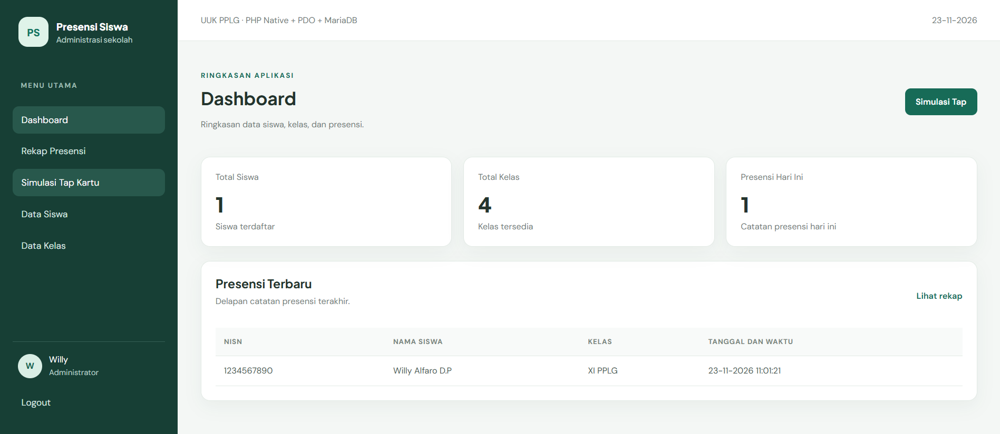
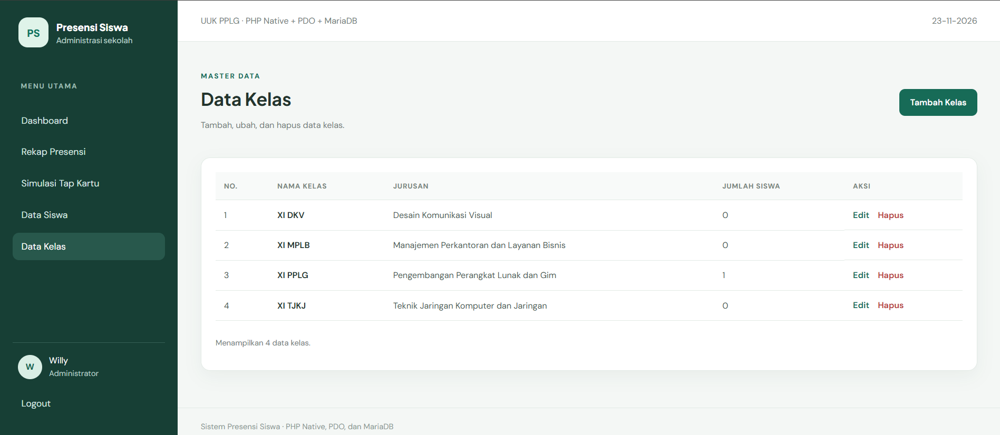
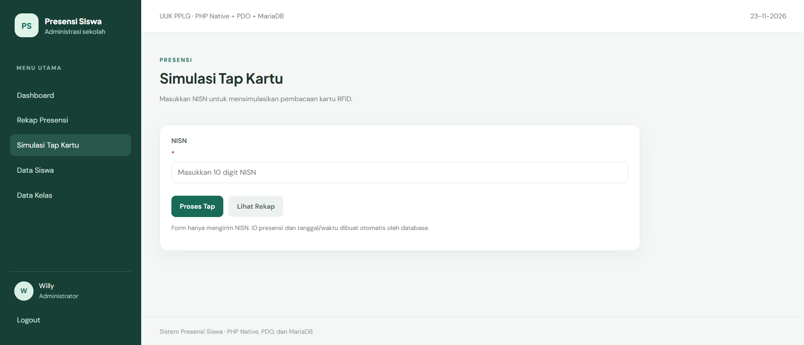

# Sistem Presensi Siswa

Aplikasi web untuk mengelola data kelas, data siswa, dan pencatatan kehadiran siswa melalui simulasi tap kartu menggunakan NISN. Project ini dibuat sebagai bagian dari Uji Unjuk Kerja (UUK) PPLG dengan PHP Native, PDO, dan MariaDB.

> **Catatan:** Fitur tap pada aplikasi ini merupakan simulasi melalui input NISN. Integrasi dengan perangkat keras atau kartu RFID fisik tidak termasuk dalam project ini.

---

## Daftar Isi

- [Tentang Aplikasi](#tentang-aplikasi)
- [Fitur Aplikasi](#fitur-aplikasi)
- [Teknologi](#teknologi)
- [Persyaratan](#persyaratan)
- [Instalasi dan Menjalankan Aplikasi](#instalasi-dan-menjalankan-aplikasi)
- [Akun Demo](#akun-demo)
- [Database dan ERD](#database-dan-erd)
- [Struktur Folder](#struktur-folder)
- [Hasil Pengujian](#hasil-pengujian)
- [Tangkapan Layar](#tangkapan-layar)

---

## Tentang Aplikasi

**Sistem Presensi Siswa** adalah aplikasi berbasis web yang membantu administrator mengelola informasi kelas dan siswa serta mencatat kehadiran siswa. Pencatatan presensi dilakukan melalui halaman **Simulasi Tap Kartu** dengan memasukkan NISN siswa. Jika NISN terdaftar, aplikasi menyimpan catatan presensi dan MariaDB mengisi tanggal serta waktu secara otomatis.

Aplikasi ini menggunakan satu jenis akun, yaitu **Administrator**. Administrator dapat masuk ke aplikasi untuk mengelola data kelas, data siswa, dan catatan presensi.

## Fitur Aplikasi

| Fitur | Keterangan |
|---|---|
| Login dan logout | Administrator masuk menggunakan username dan password, lalu dapat mengakhiri sesi melalui fitur logout. |
| Dashboard | Menampilkan ringkasan data kelas, siswa, presensi hari ini, dan catatan presensi terbaru. |
| Kelola kelas | Menampilkan, menambahkan, mengubah, dan menghapus data kelas. Kelas yang masih memiliki siswa tidak dapat dihapus. |
| Kelola siswa | Menampilkan, mencari, menambahkan, mengubah, dan menghapus data siswa. |
| Validasi NISN | Memastikan NISN berisi tepat 10 digit dan tidak digunakan oleh siswa lain. |
| Simulasi tap kartu | Menerima NISN siswa terdaftar dan menyimpan catatan presensi dengan waktu otomatis. |
| Rekap presensi | Menampilkan catatan presensi beserta informasi siswa dan kelas, serta menyediakan pencarian dan filter. Catatan presensi yang keliru dapat dihapus. |

## Teknologi

- **Bahasa pemrograman:** PHP Native
- **Database:** MariaDB / MySQL
- **Koneksi database:** PDO
- **Frontend:** HTML dan CSS
- **Server lokal:** Laragon (Apache dan MariaDB)

## Persyaratan

Sebelum menjalankan aplikasi, siapkan:

- Sistem operasi Windows.
- Laragon yang menyediakan Apache, PHP, dan MariaDB.
- PHP dengan ekstensi `pdo` dan `pdo_mysql` aktif.
- Browser web.

## Instalasi dan Menjalankan Aplikasi

Ikuti langkah-langkah berikut untuk menjalankan project secara lokal menggunakan Laragon.

### 1. Letakkan folder project

Ekstrak folder project ke direktori web Laragon. Contoh lokasi:

```text
C:\laragon\www\UUK
```

Pastikan file `login.php`, `schema.sql`, dan folder `app`, `config`, `kelas`, `siswa`, serta `presensi` berada di dalam folder `UUK`.

### 2. Jalankan Laragon

Buka Laragon, kemudian jalankan layanan **Apache** dan **MariaDB**.

### 3. Import database

1. Buka phpMyAdmin melalui Laragon.
2. Pilih menu **Import**.
3. Pilih file `schema.sql` yang berada di folder utama project.
4. Jalankan proses import.

File `schema.sql` akan membuat database bernama `presensi_siswa` beserta tabel `kelas`, `siswa`, `presensi`, dan `users`.

### 4. Periksa konfigurasi database

Buka file:

```text
config/database.php
```

Konfigurasi bawaan untuk Laragon adalah sebagai berikut:

| Pengaturan | Nilai bawaan |
|---|---|
| Host | `127.0.0.1` |
| Database | `presensi_siswa` |
| Username | `root` |
| Password | Kosong |
| BASE_URL | `/UUK` |

Sesuaikan konfigurasi tersebut apabila username, password, host MariaDB, atau nama folder project berbeda.

### 5. Buat akun administrator

Buka alamat berikut melalui browser:

```text
http://localhost/UUK/setup_admin.php
```

Buat satu akun administrator. Ketentuan username pada aplikasi adalah 3–50 karakter dan hanya boleh menggunakan huruf, angka, titik, garis bawah, atau tanda hubung. Password minimal 8 karakter.

### 6. Hapus file setup

Setelah akun administrator berhasil dibuat, **hapus file `setup_admin.php`** dari folder project. File tersebut hanya digunakan untuk membuat akun administrator pertama kali.

### 7. Login ke aplikasi

Buka alamat berikut:

```text
http://localhost/UUK/
```

Masuk menggunakan username dan password administrator yang telah dibuat. Setelah berhasil login, halaman Dashboard akan ditampilkan.

## Akun Demo

Gunakan **satu akun administrator** yang sama untuk pengujian dan demonstrasi aplikasi. Isi bagian berikut menggunakan username dan password demo yang benar-benar sudah dibuat melalui `setup_admin.php`.

| Keterangan | Akun Demo |
|---|---|
| Jenis akun | Administrator |
| Username | `ISI_USERNAME_DEMO` |
| Password | `ISI_PASSWORD_DEMO` |

> **Sebelum README dikumpulkan:** ganti `ISI_USERNAME_DEMO` dan `ISI_PASSWORD_DEMO` dengan informasi akun demo yang benar. Gunakan akun khusus demonstrasi dan pastikan akun tersebut tersedia pada database yang digunakan saat penilaian.

## Database dan ERD

Database aplikasi bernama **`presensi_siswa`**. Database memiliki tiga tabel inti sesuai gambar kerja dan satu tabel pendukung untuk autentikasi administrator.

### ERD konseptual sesuai gambar kerja


**Relasi pada ERD:**

- **Kelas (1) — (N) Siswa:** satu kelas dapat memiliki banyak siswa, sedangkan satu siswa terdaftar pada satu kelas.
- **Siswa (1) — (N) Presensi:** satu siswa dapat memiliki banyak catatan presensi.

Pada gambar kerja, atribut Foreign Key tidak digambarkan. Kolom penghubung ditambahkan ketika ERD dikonversi menjadi tabel relasional.

### Kolom penghubung (Foreign Key)

| Tabel | Kolom | Keterangan |
|---|---|---|
| `siswa` | `id_kelas` | Foreign Key yang mengacu ke `kelas.id_kelas`. |
| `presensi` | `nisn` | Foreign Key yang mengacu ke `siswa.nisn`. |

### Rincian tabel database

#### 1. Tabel `kelas`

| Kolom | Tipe Data | Keterangan |
|---|---|---|
| `id_kelas` | `INT` | Primary Key dan Auto Increment. |
| `nama_kelas` | `VARCHAR(20)` | Nama kelas, wajib diisi dan unik. |
| `jurusan` | `VARCHAR(50)` | Nama jurusan, wajib diisi. |

#### 2. Tabel `siswa`

| Kolom | Tipe Data | Keterangan |
|---|---|---|
| `nisn` | `CHAR(10)` | Primary Key, menyimpan NISN 10 digit. |
| `nama` | `VARCHAR(100)` | Nama siswa, wajib diisi. |
| `alamat` | `VARCHAR(255)` | Alamat siswa, boleh kosong. |
| `id_kelas` | `INT` | Foreign Key yang mengacu ke `kelas.id_kelas`. |

#### 3. Tabel `presensi`

| Kolom | Tipe Data | Keterangan |
|---|---|---|
| `id` | `INT` | Primary Key dan Auto Increment. |
| `nisn` | `CHAR(10)` | Foreign Key yang mengacu ke `siswa.nisn`. |
| `tanggal_waktu` | `DATETIME` | Waktu presensi, otomatis menggunakan `CURRENT_TIMESTAMP`. |

#### 4. Tabel `users` (pendukung login)

| Kolom | Tipe Data | Keterangan |
|---|---|---|
| `id_user` | `INT` | Primary Key dan Auto Increment. |
| `username` | `VARCHAR(50)` | Username administrator dan harus unik. |
| `password` | `VARCHAR(255)` | Menyimpan password dalam bentuk hash. |

Tabel `users` merupakan tabel pendukung autentikasi administrator dan bukan bagian dari tiga entitas utama pada ERD gambar kerja.

## Struktur Folder

```text
UUK/
├── app/
│   ├── bootstrap.php
│   ├── helpers.php
│   └── models/
│       ├── BaseModel.php
│       ├── Kelas.php
│       ├── Siswa.php
│       ├── Presensi.php
│       └── User.php
├── assets/
│   └── css/
│       └── style.css
├── config/
│   └── database.php
├── docs/
│   ├── erd.svg
│   └── screenshots/
├── kelas/
│   ├── create.php
│   ├── edit.php
│   ├── delete.php
│   └── index.php
├── layouts/
│   ├── header.php
│   ├── navbar.php
│   └── footer.php
├── presensi/
│   ├── tap.php
│   ├── index.php
│   └── delete.php
├── siswa/
│   ├── create.php
│   ├── edit.php
│   ├── delete.php
│   └── index.php
├── dashboard.php
├── index.php
├── login.php
├── logout.php
├── schema.sql
└── setup_admin.php
```

## Hasil Pengujian

Pengujian berikut merupakan delapan skenario yang telah dijalankan pada aplikasi.

| No. | Skenario Pengujian | Hasil yang Diharapkan | Hasil Pengujian |
|---:|---|---|---|
| 1 | Login menggunakan password yang salah. | Login ditolak dan pesan kesalahan ditampilkan. | **Lulus** |
| 2 | Membuka halaman yang dilindungi melalui URL tanpa login. | Pengguna diarahkan ke halaman login. | **Lulus** |
| 3 | Menambahkan siswa dengan NISN 9 digit. | Validasi menolak data, pesan kesalahan tampil, dan isian form tidak hilang. | **Lulus** |
| 4 | Menambahkan siswa dengan NISN yang sudah terdaftar. | Data ditolak dan pesan bahwa NISN sudah terdaftar ditampilkan. | **Lulus** |
| 5 | Simulasi tap menggunakan NISN yang tidak terdaftar. | Tap ditolak dan pesan yang jelas ditampilkan. | **Lulus** |
| 6 | Simulasi tap menggunakan NISN yang valid. | Catatan muncul pada rekap hari ini dengan waktu otomatis. | **Lulus** |
| 7 | Menghapus kelas yang masih memiliki siswa. | Penghapusan ditolak dan alasan ditampilkan. | **Lulus** |
| 8 | Mencari siswa menggunakan sebagian nama. | Hanya siswa yang sesuai dengan kata pencarian ditampilkan. | **Lulus** |

## Tangkapan Layar

Masukkan tangkapan layar asli dari aplikasi yang berjalan ke folder `docs/screenshots/`. Gunakan nama file yang sama seperti contoh di bawah agar gambar tampil di README.

### 1. Halaman Login


### 2. Dashboard



### 3. Data Kelas



### 4. Data Siswa


### 5. Simulasi Tap Kartu



### 6. Rekap Presensi


> Pastikan keenam file gambar tersebut sudah dimasukkan sebelum project dikumpulkan. Simpan screenshot dengan format PNG dan gunakan nama file yang tercantum pada setiap bagian.

---

## Informasi Project

- **Nama aplikasi:** Sistem Presensi Siswa
- **Jenis project:** Uji Unjuk Kerja (UUK) PPLG
- **Metode presensi:** Simulasi tap berdasarkan NISN
- **Database:** `presensi_siswa`
- **File database:** `schema.sql`

---

**Dibuat untuk memenuhi kebutuhan project Uji Unjuk Kerja (UUK) PPLG.**
